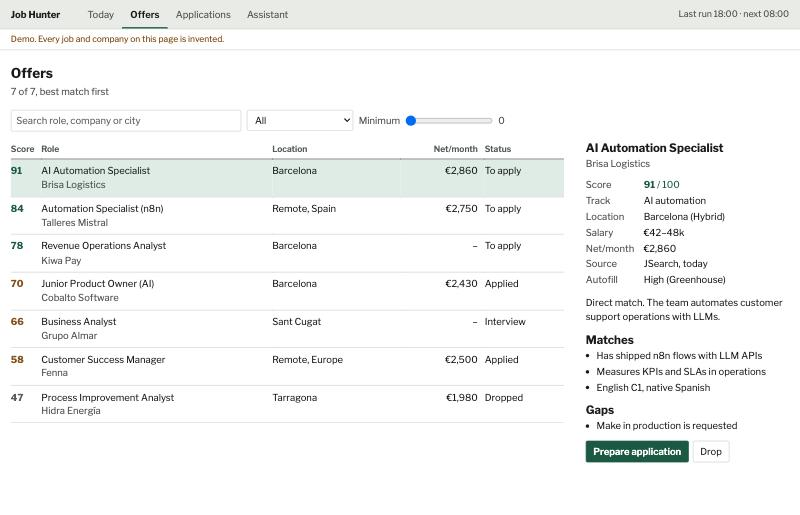

# Job Hunter

An n8n workflow I use to look for work. Twice a day it pulls offers from job APIs and Gmail alerts, removes duplicates, filters them with rules and asks Claude to score what is left. Results go to a Google Sheet and Telegram. It never applies for me.

[Demo of the dashboard](https://2077santi.github.io/job-hunter-n8n/demo.html), with invented jobs.



```
job APIs + Gmail alerts -> normalise -> dedupe -> rule filters -> Claude score -> Sheets + Telegram
```

A normal run receives about 1,000 offers and scores up to 40. Claude costs about $0.02 to $0.03 per run, mostly because the rules throw out nearly everything first.

If one source fails, the run continues and I get a Telegram message. Quotas and cost are logged per source.

## Things that broke

n8n's Code node has no `URL` or `URLSearchParams`. Local tests passed and the first real run failed, so I replaced them with small helpers.

JSearch returned an empty list, with no error, for long `OR` queries. It now runs short searches in rotation.

Google Sheets read `0.0115` as `115` on my Spanish-locale sheet. Numeric logs are now written as raw values.

## Setup

You need n8n 2.x, a Google Sheet, a Telegram bot and API keys. The profile in `src/config.js` is fictional. Replace it, then run:

```bash
node build.mjs
```

Import `workflows/*.json` into n8n. The full guide is in [docs/SETUP.es.md](docs/SETUP.es.md), in Spanish.

The tests that replay captured API responses are skipped here because that data is private.

## Not in this repo

I also run a private dashboard with tailored CVs and a Chrome extension that fills forms for me to review. Its code holds personal data, so only the demo is public.
